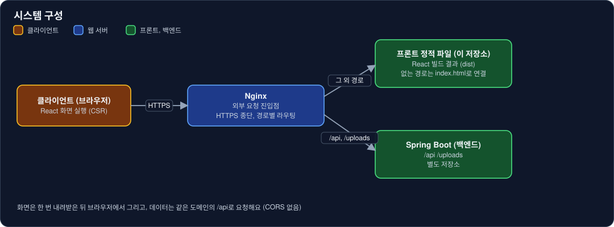
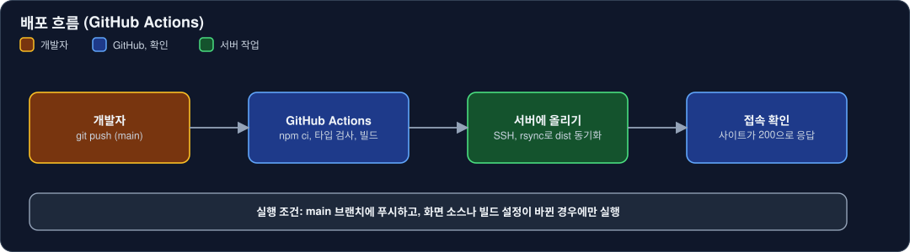

# miku-miku-reservation-frontend

예약 구매하는 굿즈의 구매 내역을 기록하고 관리하는 서비스의 프론트엔드예요.


- 서비스: https://miku-miku-reservation.com
- API 문서: https://miku-miku-reservation.com/swagger-ui.html

## 목차

- [소개](#소개)
- [주요 기능](#주요-기능)
- [기술 스택](#기술-스택)
- [시스템 구성](#시스템-구성)
- [폴더 구조](#폴더-구조)
- [설계 포인트](#설계-포인트)
- [배포](#배포)
- [관련 저장소](#관련-저장소)

## 소개

예약 구매하는 굿즈(피규어 등)를 한곳에 모아 기록하는 장부의 화면이에요.
상품마다 어디서, 얼마에, 어떤 방식으로 샀는지와 지금 어느 단계인지를 남겨요.

상품은 아래 순서로만 넘어가요. 되돌릴 수 없고, 단계를 넘길 때 입력한 값(예약금, 결제일, 잔금 기한 등)은 이후 수정할 수 없어요. 잘못 넣었다면 삭제하고 다시 등록해요.

```
장바구니 → 미구매 → (예약완료) → 구매완료 → 배송완료
```

## 주요 기능

| 구분 | 내용 |
|---|---|
| 상품 | 상태별 탭 목록, 상세, 등록과 수정(설명은 리치 텍스트 에디터), 선택 모드로 일괄 삭제와 일괄 상태 변경, 상세에서 개별 상태 전이 |
| 분류 | 판매처, 형태, 시리즈, 장르와 캐릭터, 제조사를 상위 분류와 하위 분류로 관리, 썸네일 지정 |
| 마감 알림 | 미구매 상품의 예약마감일이 2개월 안이면 깜빡임, 1개월 안이면 모달로 알림. 예약완료 상품은 입력한 잔금 기한으로 같은 규칙 적용 |
| 계정 | 이메일 인증 가입, 로그인, 아이디 찾기, 비밀번호 재설정, 마이페이지(프로필 이미지, 비밀번호 변경, 탈퇴) |

## 기술 스택

| 구분 | 사용 기술 |
|---|---|
| 언어, 빌드 | TypeScript, React 19, Vite |
| UI | MUI, emotion(`styled()`), motion(애니메이션), sweetalert2(확인창) |
| 라우팅, 상태 | react-router-dom, zustand |
| 폼 | react-hook-form |
| 통신 | axios, js-cookie |
| 에디터, 날짜 | Tiptap, dayjs, @mui/x-date-pickers |
| 보안 | DOMPurify (설명 HTML 정화) |
| 서버 | Nginx(정적 파일 서빙과 API 프록시), Let's Encrypt |
| 배포 | GitHub Actions |

## 시스템 구성



브라우저는 화면 파일(`dist`)을 한 번 내려받은 뒤 직접 그리고, 데이터는 같은 도메인의 `/api`로 요청해요. 그래서 운영에서는 CORS가 필요 없어요.

## 폴더 구조

도메인 폴더 아래에 역할별 폴더(`page`, `component`, `hook`, `service`, `interface`, `constant`, `utils`)를 둬요.

```
src
├── app
│   ├── auth        로그인, 가입, 아이디 찾기, 비밀번호 재설정
│   ├── figure      상품 목록, 상세, 등록과 수정, 상태 전이
│   ├── category    분류 관리
│   ├── my-page     내 정보, 비밀번호 변경, 탈퇴
│   └── common      공통 컴포넌트, 공통 스타일, 검증 등 유틸
├── config
│   ├── axios       API 클라이언트, 응답 코드
│   ├── route       라우트 테이블과 인증 가드
│   └── theme       MUI 테마
├── store           전역 상태 (인증, UI)
└── utils           쿠키 등
```

## 설계 포인트

- **인증**: JWT를 쿠키(24시간)에 두고, axios 요청 인터셉터가 `Authorization: Bearer`로 붙여요. 401/403이면 쿠키와 스토어를 비워요. 앱을 켤 때 `GET /api/auth/me`로 로그인 상태를 복원해요.
- **서비스 훅**: API 호출은 `service/`의 훅으로 모아요. 조회 훅은 `{ 데이터, 로딩, fetch }`를 돌려주고, 변경 훅은 `fetch`가 결과 코드를 담은 응답을 돌려줘서 페이지가 `code`로 바로 분기해요. 컴포넌트는 이 반환 형태에만 의존해요.
- **공통 모듈만 사용**: 색, 모서리, 간격은 `theme.ts`와 `common/style`의 공통 스타일에서만 가져와요. 화면 파일에서 새로 정의하지 않고, `sx`는 ESLint로 막아 뒀어요.
- **폼 검증**: react-hook-form의 `onTouched` 동작을 그대로 쓰고, 검사 규칙과 문구는 `ValidationUtils`의 이름 있는 함수(`validateXxx`) 한 곳에 둬요.
- **설명 HTML**: 에디터 결과는 `HtmlView` 한 곳에서만 DOMPurify로 정화해 그려요. 에디터가 저장하는 이미지 `src`는 `/uploads/...` 상대 경로를 그대로 유지해요(절대 경로면 서버가 상품에 연결하지 못해 일정 시간 뒤 이미지를 지워요).
- **라우트**: `APP_ROUTES` 테이블 하나로 상단 메뉴와 인증 가드를 함께 만들어요. 로그인이 필요한 화면은 미로그인이면 `/login`으로 보내고, 로그인 뒤 원래 경로로 돌아와요.
- **이메일 인증 흐름 공유**: 가입, 아이디 찾기, 비밀번호 재설정이 같은 훅(`useEmailVerification`)과 인증 코드 입력 컴포넌트를 써요.

## 배포

`main` 브랜치에 푸시하면 GitHub Actions가 자동으로 배포해요.



1. 화면 소스나 빌드 설정(`src/**`, `public/**`, `package.json`, `vite.config.ts`, `.env.production` 등)이 바뀐 푸시에만 실행
2. `npm ci`와 `npm run build`로 `dist/` 생성
3. SSH로 서버에 접속해 rsync로 `dist/`를 그대로 맞춤 (서버에만 남은 옛 파일은 삭제)
4. 사이트 주소가 `200`으로 응답하는지 확인

## 관련 저장소

| 저장소 | 설명 |
|---|---|
| [miku-miku-reservation-backend](https://github.com/jongHyeon0000/miku-miku-reservation-backend) | Spring Boot REST API 백엔드 |
